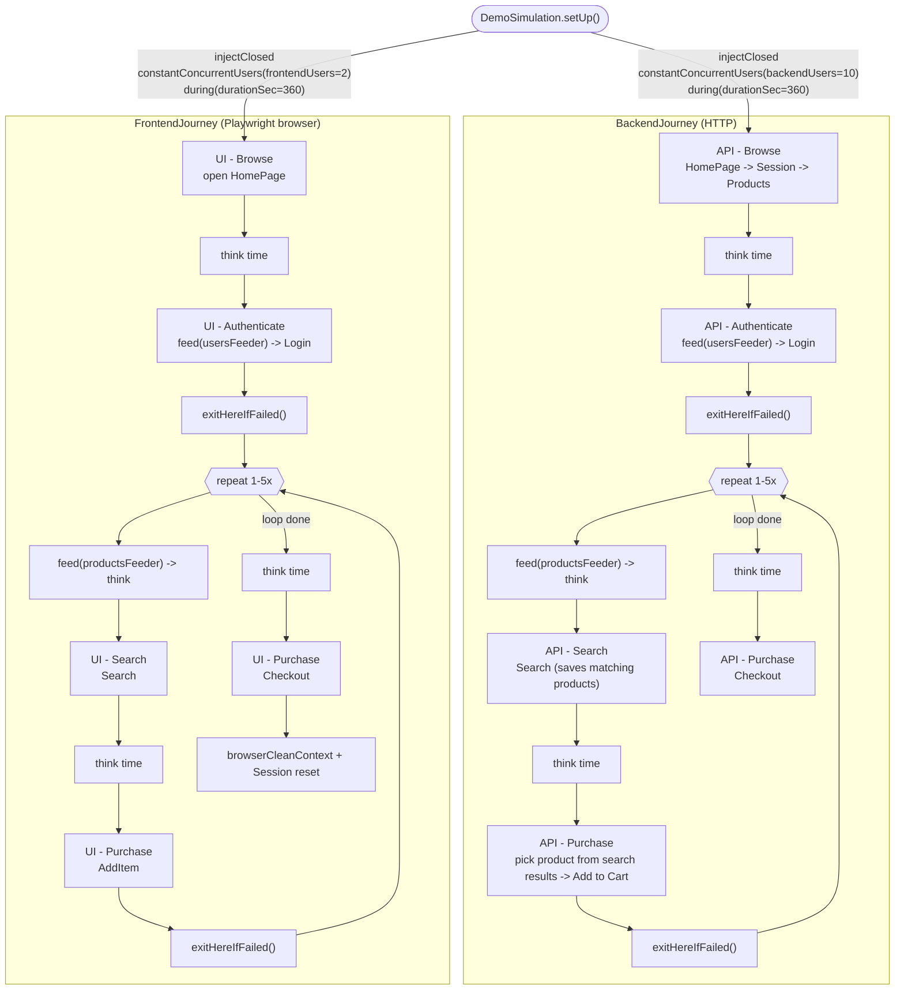

# gatling-playwright-demo

Showcase of [`gatling-playwright-plugin`](https://github.com/i-nahornyi/gatling-playwright-plugin):
it exposes a real Playwright browser session as a regular Gatling `ProtocolBuilder`, so one
`setUp(...)` can inject classic HTTP virtual users and real-browser virtual users side by side,
in the same simulation, against the same ecommerce demo site.

> [!WARNING]
> **Don't use the browser protocol to generate load.** Each browser virtual user is a real
> Chromium process - it doesn't scale to thousands of users the way an HTTP request does, and
> trying to use it that way will just exhaust your own machine/CI runner, not the system under
> test.
>
> Use it instead as a small, constant number of **real-user probes** that keep clicking through
> the same journey a human would, while your actual load comes from plain HTTP virtual users
> hitting the backend. That turns "how much load can we throw at this" into "how does backend
> load affect what a real user actually experiences" - page load times, click responsiveness,
> UI metrics (FCP/LCP/TTFB/CLS via `.enableUIMetrics()`) - which a pure HTTP test can't tell you
> at all.

### Build
```shell
docker build -t gatling-playwright . --no-cache
```

### Run
```shell
docker run --rm -v gatling_result:/gatling_test/target/gatling \
                      gatling-playwright \
                      com.demo.simulation.DemoSimulation
```

### Simulations in this repo

- **`DemoSimulation`** - the main example. Heavy HTTP load (`backendUsers`, default 10) against
  the API, plus a couple of real browsers (`frontendUsers`, default 2) running the exact same
  journey through the UI, so you can see how the former affects the latter.
- **`BrowserOnlySimulation`** - just the browser journey, no backend load pressure. Useful as a
  starting point for a pure UI functional/regression scenario.
- **`SyntheticMonitoring`** - no injected load at all: one browser repeatedly opening a list of
  pages (`feeders/page.csv`) with a custom page-load validation script, the classic "is the site
  up and fast" synthetic monitoring check.

### Adding your own flow

Every locator and flow in this repo was discovered by driving the live site with
`playwright-cli` first - snapshotting it, clicking around, checking what requests an action
actually fires - rather than guessing selectors. See
[`docs/playwright-discovery.md`](docs/playwright-discovery.md) for that walkthrough before
adding your own.

### Load model

`DemoSimulation` injects two scenarios built from the same two reusable journeys
(`BackendJourney`, plain HTTP; `FrontendJourney`, a real Playwright browser), both
walking the same four stages - Browse, Authenticate, Search, Purchase. Note the
imbalance in the injection profiles below: lots of backend HTTP users, few browser
ones - that imbalance is the whole point (see the warning above).

